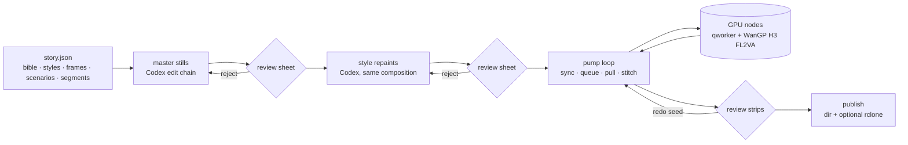

# storyboard-to-video

This pipeline turns a written story into silent, illustrated explainer videos. The characters, room and props stay consistent from frame to frame.

It works in three stages:

1. **Stills.** You describe every frame in one JSON *story spec*. The OpenAI image model (driven through `codex exec`) paints the frames one by one, each frame an edit of the one before.
2. **Styles.** The same frames are repainted in other looks. The composition stays the same, so one set of motion descriptions works for every style.
3. **Video.** MiniMax H3 animates each pair of consecutive stills. It is a first-frame/last-frame video model, run through [WanGP](https://github.com/deepbeepmeep/Wan2GP) on your GPU machines. The clips are then stitched into one video per scenario.

The process is semi-automated. A queue loop does the mechanical work: syncing files, queueing jobs, collecting results and stitching. A person looks at contact sheets and frame strips and decides what to keep, redraw or re-render.

`examples/starter/` is a minimal, runnable production skeleton: one scene, one short edit chain, two scenarios and two styles. Use it as the starting point for a new production; everything creative lives in that one JSON file.



## Requirements

| where | what |
|---|---|
| control machine (macOS or Linux) | Python ≥ 3.10 with Pillow (`pip install -r requirements.txt`), `ffmpeg`/`ffprobe`, `rsync`, `ssh`; `rclone` only if you publish to cloud storage |
| control machine | [Codex CLI](https://github.com/openai/codex) ≥ 0.164, signed in, with the `image_generation` feature (stable and on by default; check with `codex features list \| grep image_generation`) |
| GPU node(s) | Linux + NVIDIA. H3 FL2VA pruned int8 runs on a DGX Spark (GB10, 128 GB unified memory) with WanGP memory profile 1 (everything resident). Cards with less memory need a lower-memory WanGP profile: set `"profile"` in the spec's `h3` block (untested) |
| GPU node(s) | the controller reaches each node with key-based `ssh`; one jump host is allowed per node |

## Quick start

```bash
# 1. on each GPU node: install WanGP + H3 weights, then start the queue worker
git clone <this repo> && cd storyboard-to-video
bash worker/provision_wangp.sh
tmux new -d -s sbq 'bash worker/qworker.sh ~/sbq'

# 2. on the control machine
pip install -r requirements.txt
cp config.example.json config.json            # edit: your nodes, their root dir (~/sbq above), work dir
export STORYBOARD_SPEC=examples/starter/story.json STORYBOARD_CONFIG=config.json

python -m storyboard check                    # validate the spec, print scenarios and durations
python -m storyboard stills                   # make every still; ~100 s per generated image
python -m storyboard sheet master             # contact sheet per style -> work/<story>/<style>/sheet.png
python -m storyboard reject master f2         # redraw a bad still (cascades to its repaints and dependants)
python -m storyboard run --every 300          # the loop: sync, queue, pull, stitch (leave it running)
python -m storyboard status                   # what is done / queued / failed
python -m storyboard redo paper f1__f2        # re-render one clip with the next seed
python -m storyboard publish master/bench     # copy reviewed videos to the publish dir (+ rclone)
python -m storyboard stop                     # pause: nothing new is queued, even by a running loop; `resume` undoes it
```

A spec can ship its approved stills in a directory and set `seed_dir` on each style. With that, `stills` only imports files and the pipeline goes straight to video. Delete or rename a seed dir to regenerate that style from scratch.

Dry runs that touch nothing:

- `python -m storyboard stills --dry-run` prints every Codex prompt with its attachments.
- `python -m storyboard prompt paper f2` prints the prompt for one still.
- `python -m storyboard h3-task paper f1 f2` prints the exact WanGP task for one segment.

## The story spec

There is one JSON file per production. Paths are relative to that file. `examples/starter/story.json` is the reference.

| key | meaning |
|---|---|
| `name` | story id; used in remote paths and task names |
| `bible` | the continuity text restated in every master prompt: room layout, where every prop lives, the characters' exact look, style, and "no text / no extra people" rules |
| `master_style` | the style whose frames are generated by editing (all other styles repaint it) |
| `anchor_frame` | the frame that defines each style's look (usually the first frame) |
| `styles.<id>` | `look` (one sentence used in both the repaint prompt and the H3 prompt), optional `ref` (a style reference image), optional `seed_dir` (approved stills to import instead of generating), `label` |
| `frames.<id>` | `action` (what this still shows), `parent` (the frame it is edited from; omit for a chain's first frame), optional `refs` (`[{path, role}]`; `@<style>/<frame>` and `@assets/<name>` point at generated images), optional `text` (the only on-screen text or symbols this frame may show, e.g. `the green number "+1" above the box`; without it every prompt forbids text) |
| `scenarios.<id>` | ordered frame ids: one video each. Scenarios share frames, and shared segments render once per style |
| `key_frames.<id>` | the frame shown for that scenario in the publish overview |
| `segments[]` | `{from, to, frames, path}`: one H3 clip. `frames` must be on WanGP's H3 grid (17k+5: 107, 124, 141, 158, 175, …, 243). `path` describes the motion from the first still to the second. Optional `scene` replaces `h3.scene` for this segment: use it when the segment has its own camera (an insert), because a scene text that contradicts the stills makes H3 cut to the scene it describes. Optional `inject: [{frame, at}]` adds keyframes the clip must pass through exactly at frame `at` (FL2VA frame injection; the frame must exist in `frames`, and `stills` makes it in every style). Use it when H3 keeps inventing an in-between state you can't prompt away |
| `h3` | `scene` (the fixed description of the set for every H3 prompt), `resolution`, `fps`, `model`, `profile` (WanGP memory profile, default 1), `settings` (WanGP overrides merged over the defaults below) |
| `render_order` | `scenario` (default: each scenario in every style before the next scenario) or `style` (every scenario in the first-listed style before the next style; list the master first to get a full reviewable pass early) |
| `qa_watch` | optional `[{name, box: [x0,y0,x1,y1] as frame fractions, max, segments?, enforce?}]` (`enforce: false` = report in `qa` only, for boxes a character moves through): regions that must not change in the listed segments (a button nobody may touch, a door that must stay shut). `pump` refuses any clip whose region differs from both its stills by more than `max` and renders the next seed (up to `max_seeds`); `qa` reports the same check. 25 worked: touches scored 32–52, clean clips 8–22 |
| `assets.<id>` | extra images such as character / prop model sheets: `prompt` + `refs` |

## How the consistency is achieved

These rules came out of many rejected attempts. Keep them when you write a new story.

1. **One locked camera per scenario.** H3 interpolates between two stills. If the framing changes between them, the clip fails. Varied camera angles belong in separate shots with their own `scene` text, or in a separate previs-driven production.
2. **Edit chains, not fresh images.** Every master frame is an edit of its parent frame, with the chain's first frame attached as the canonical look. The bible is restated in every prompt. A frame changes only what its action requires.
3. **Announce every attachment's role.** Each prompt says, for example, "Attached image 2: frame 1 of this story, the canonical look of the room and characters". Unlabelled references get blended.
4. **Styles are repaints of approved master frames.** Each repaint is anchored to the style's own repaint of the anchor frame plus a style reference image. The prompt also restates what the frame shows. Without that, object states drift: empty containers came back full.
5. **Each piece of motion runs between two approved stills.** Both ends of every clip have been reviewed. Stitching drops the duplicated boundary frame, and the joins are nearly invisible.
6. **Write state changes explicitly.** If a container is empty, a door is shut or an object sits back in its place, say so in the action. Image models default to "full" and "tidy".
7. **Generate, review, redraw.** It is cheaper to redraw one still (~100 s) or re-render one clip with a new seed (~10 min) than to fix things downstream. Running several parallel master chains and keeping the most consistent one also works (use separate `work` dirs).

## Video settings (H3 FL2VA through WanGP)

| setting | value | why |
|---|---|---|
| model | `minimax_h3_fl2va_pruned` (int8 weights) | first + last frame to video; pruned rank-8 int8 fits beside the 32B text encoder |
| `image_prompt_type` | `SE` | start and end image |
| `config` | `gguf_q4_k_m` | Q4_K_M GGUF Qwen3-VL-32B text encoder |
| `multi_prompts_gen_type` | `FG` | **required**: any other mode splits the H3 prompt into several generation requests |
| LoRA | Lightx2v FL2V turbo 8-step (`loras_multipliers 1.0`) | 8 steps instead of 20–30; every reviewed clip so far used it and passed review (it was not A/B'd against the full-step model) |
| steps / guidance / flow_shift | 8 / 1 / 12 | turbo LoRA settings |
| resolution | 1344x768, stitched up to 1920x1080 | |
| prompt | MiniMax's official FL2VA layout: alignment line, `integrated_multimodal_description`, `overall_soundscape: N/A`, `non_diegetic_music: N/A` | see [MiniMax-H3 skills](https://github.com/MiniMax-AI/MiniMax-H3/tree/main/skills); H3 also makes audio, which the stitch drops |

Measured on one DGX Spark (GB10) per clip, including model load: 124 frames ≈ 8.5 min, 175 frames ≈ 14 min, 243 frames ≈ 22–24 min. Keep segments at 175 frames or fewer; cost grows faster than linearly with length. Codex stills take about 100 s each, and 6–8 can run in parallel.

## Reviewing

`pump` writes these for every finished video:

- `work/<story>/<style>/<scenario>.mp4`
- `<scenario>_strip.png`: one row of 8 frames per segment
- a `pending-review` row in `work/<story>/ledger.jsonl`

`python -m storyboard qa <style>` is the actual review tool. It scores every clip against its two endpoint stills: a zoom, a cut or invented content makes some frame unlike both, scoring above 2, while clean clips score below about 1.8. It also writes a 0.5 s frame grid for each video to `<style>/qa/`. Look through every grid: the 8-frame strip misses events shorter than a second, such as a quick press.

What to look for, and the fix for each:

| symptom | fix |
|---|---|
| wrong object state in a still (full container, missing prop, door open) | make the action explicit, then `reject <style> <frame>` and `stills` |
| a character teleports between stills (for example, standing in two different places) | rewrite the action so positions are continuous, then `reject` |
| clip artifact that is not in either still (ghost marks, melting limbs) | `redo <style> <seg>` (next seed) |
| style drifts back toward the master look inside a clip | redo with the next seed; if it repeats, strengthen that style's `look` |
| a moment looks odd in the strip | check it at full resolution: `ffmpeg -ss <sec> -i video.mp4 -frames:v 1 x.png` |
| a hand presses or touches something it must not | the stills put the hand too close to it: move the hand far away in both stills (`reject` + `stills`); prompt wording alone does not stop it |
| a person or object appears that the stills don't show, or the shot cuts to another set | the H3 scene text names it: give the segment its own `scene` that matches its stills |
| camera push-in or zoom | `redo` (next seed) |

Rejecting a master frame cascades to every style's repaint and to child frames. It also deletes the affected clips and pulls their queued tasks back.

## Operating the queue

- The node layout under `root` is `stills/<story>/<style>/`, `queue/`, `done/`, `failed/`, `logs/` and `out/<story>/<style>/`.
- The worker runs one task per process. On unified-memory GPUs, memory is released only when the process exits. A `MemAvailable` watchdog kills a task before the machine wedges; long single-process rendering runs did hang nodes after hours.
- Task names start with a priority number, and the worker runs them in name order. The default order is scenario by scenario, each scenario in every style. `requeue` pulls unstarted tasks back so a changed priority takes effect.
- `pump` queues a segment only on a node that already lists both of its stills. Without this guard, work queued before the stills synced fails within seconds.
- `stop` pauses the story. It writes a persisted flag (`work/<story>/PAUSED`) and pulls every unstarted task off the nodes.
  - While the flag exists, every `pump`, including one inside a running `run` loop, queues nothing. Each paused pump also pulls back any task file that slipped in, so a loop that was mid-cycle cannot undo the pause.
  - Tasks already running finish, and their clips are still collected and stitched.
  - `resume` removes the flag. Stopping the `run` loop itself (Ctrl-C) is optional.
- Failed tasks get the next seed, up to `max_seeds` (default 3).

## Repository layout

```
storyboard/            the pipeline (python -m storyboard)
  spec.py              story spec loader + validation, H3 defaults
  images.py            Codex stills: master edit chains, style repaints, assets, contact sheets
  render.py            H3 task builder, nodes over ssh/rsync, the pump loop, publish + overview
  media.py             ffmpeg stitch, review strips
  qa.py                clip scoring against endpoint stills, review grids
  cli.py               argument parsing for every subcommand
worker/                runs on the GPU nodes
  provision_wangp.sh   WanGP + H3 weights
  qworker.sh           queue worker with memory watchdog
  gen.py               one WanGP task per process
config.example.json    nodes + work dir
SKILL.md               the same pipeline written for an AI agent
examples/starter/      a minimal production skeleton to copy and fill in
```
